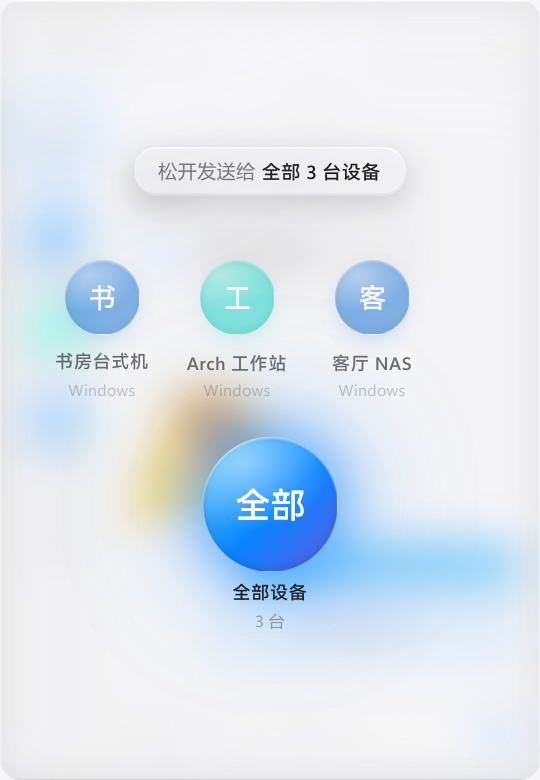
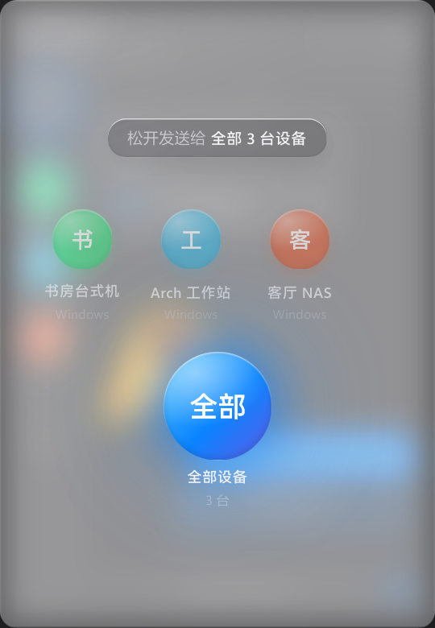
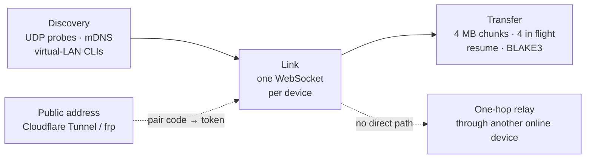

<div align="center">


# Lancat

**A portal on the edge of your screen.**<br>
Between your own computers: zero-config discovery, no accept prompts, just drag and drop.

[](https://github.com/motto1/Lancat/releases/latest)
[](https://github.com/motto1/Lancat/actions/workflows/release.yml)
[](LICENSE)


[简体中文](README.md) · English

<br>


</div>

<br>

<table>
<tr>
<td width="33%" valign="top">

### 🔍 Zero config
Devices on the same LAN find each other. So do devices on Tailscale, EasyTier, ZeroTier or NetBird. No IPs, no pairing.

</td>
<td width="33%" valign="top">

### ⚡ No prompts
They are all your devices, so files, folders, text and animated emoji just arrive. Resumable, every chunk checked with BLAKE3.

</td>
<td width="33%" valign="top">

### 🪶 Featherweight
Native Rust + Slint, one process. About 9 MB private memory when idle, 0.01–0.06% CPU. Most of the time it is a thin line on the edge.

</td>
</tr>
</table>

## Features

| | Windows 10 / 11 | Linux (Wayland) |
|---|:---:|:---:|
| Docks to a screen edge, opens on hover or when a file is dragged near | ✅ | ✅ wlr-layer-shell |
| Liquid-glass open / close animation | ✅ | ✅ |
| One chat per device, multi-select broadcast, drop on an avatar to send | ✅ | ✅ |
| 116 Noto animated emoji, Telegram sticker import | ✅ | ✅ |
| Offline queue, resent when the peer comes back | ✅ | ✅ |
| Virtual-LAN direct links, automatic one-hop relay | ✅ | ✅ |
| Public connect (Cloudflare Tunnel / frp + pair code) | ✅ | ✅ |
| Notifications, tray, start on login | ✅ | ✅ SNI tray |
| IME input | ✅ | ✅ text-input-v3 |
| Connection diagnostics | ✅ incl. one-click firewall fix | ✅ |
| One-click update (SHA256 verified) | ✅ | ✅ |

## Screenshots

<table>
<tr>
<td align="center"><br><sub>Chat</sub></td>
<td align="center"><br><sub>Animated emoji</sub></td>
<td align="center"><br><sub>Drop to pick a device</sub></td>
</tr>
<tr>
<td align="center"><br><sub>Dark</sub></td>
<td align="center"><br><sub>Dark</sub></td>
<td align="center"><br><sub>Dark</sub></td>
</tr>
</table>

## Download

| OS | Single file (recommended) | Archive |
|---|---|---|
| Windows 10 / 11 x64 | [lancat-slint-windows-x64.exe](https://github.com/motto1/Lancat/releases/latest/download/lancat-slint-windows-x64.exe) | [Releases](https://github.com/motto1/Lancat/releases/latest) |
| Linux x64 (Wayland) | [lancat-slint-linux-x64](https://github.com/motto1/Lancat/releases/latest/download/lancat-slint-linux-x64) | [Releases](https://github.com/motto1/Lancat/releases/latest) |

Every release ships `SHA256SUMS`. The binaries are unsigned, so Windows SmartScreen may warn; choose "Run anyway". The UI is in Chinese for now.

## Get started

1. **Run Lancat on each computer**, from any writable folder (not Program Files). On Linux, `chmod +x` first.
2. **Wait a few seconds.** Devices on the same network or virtual LAN appear in the sidebar on their own.
3. **Drag a file to the screen edge.** Drop it on an avatar to send it there, or on "全部" (All) to send it to every device.

> Not on the same network? Use "+ 添加" (Add) in the sidebar and enter the other side's public address and pair code.

## How it connects



Details: [docs/architecture.md](docs/architecture.md) (Chinese).

## Security model

Lancat assumes **everything that can reach your LAN or virtual LAN is yours**, so there is no pairing or prompt inside it.

- Only private ranges, the subnets of local virtual adapters and manually added addresses are accepted. Public links need a pair code or token, and wrong codes are rate limited.
- Received files lose their executable bit and are never opened automatically; paths are sanitized; size limit and device / IP block lists are available.
- **Traffic inside the LAN is not encrypted.** If you share the network with devices you don't trust, use Lancat only over an encrypted overlay such as Tailscale or WireGuard. Public links through an https tunnel use wss.

## Development

```bash
git clone https://github.com/motto1/Lancat && cd Lancat/crates/lancat-slint
cargo build --release          # needs libclang (ThorVG)
```

Build dependencies, environment variables, tests and releases: [docs/development.md](docs/development.md).

## Credits & license

If Lancat saves you a few clicks, a ⭐ helps a lot.

- UI: [Slint](https://slint.dev). Lottie: [ThorVG](https://www.thorvg.org).
- Bundled emoji: Google [Noto Animated Emoji](https://googlefonts.github.io/noto-emoji-animation/), CC BY 4.0.
- Code: [GPL-3.0](LICENSE).
- Friends: [LINUX DO](https://linux.do) community.
