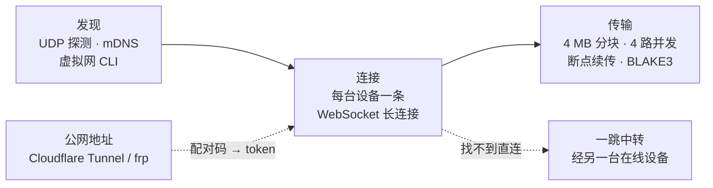

<div align="center">


# Lancat

**贴在屏幕边缘的跨设备传送门。**<br>
自己的电脑之间，零配置发现、不弹确认，拖过去就到。

[](https://github.com/motto1/Lancat/releases/latest)
[](https://github.com/motto1/Lancat/actions/workflows/release.yml)
[](LICENSE)


简体中文 · [English](README.en.md)

<br>


</div>

<br>

<table>
<tr>
<td width="33%" valign="top">

### 🔍 零配置发现
同一局域网自动互相找到；Tailscale、EasyTier、ZeroTier、NetBird 这类虚拟局域网里的设备也一样。不填 IP，不用配对。

</td>
<td width="33%" valign="top">

### ⚡ 不弹确认
都是你自己的设备，文件、文件夹、文字、动态表情直接收下。断点续传，每块 BLAKE3 校验。

</td>
<td width="33%" valign="top">

### 🪶 几乎不占资源
原生 Rust + Slint，单进程。待机私有内存约 9 MB，CPU 空闲 0.01%–0.06%；平时只是边缘一条细线。

</td>
</tr>
</table>

## 功能

| | Windows 10 / 11 | Linux (Wayland) |
|---|:---:|:---:|
| 贴边停靠，悬停或拖文件靠近即弹出 | ✅ | ✅ wlr-layer-shell |
| 液态玻璃展开 / 收起动画 | ✅ | ✅ |
| 每台设备独立会话、多选群发、拖到头像发送 | ✅ | ✅ |
| 116 个 Noto 动态表情，可导入 Telegram 贴纸 | ✅ | ✅ |
| 离线消息排队，上线自动补发 | ✅ | ✅ |
| 虚拟局域网直连、自动一跳中转 | ✅ | ✅ |
| 公网连接（Cloudflare Tunnel / frp + 配对码） | ✅ | ✅ |
| 新消息通知、托盘、开机自启 | ✅ | ✅ SNI 托盘 |
| 中文输入法 | ✅ | ✅ text-input-v3 |
| 连接诊断 | ✅ 含防火墙一键修复 | ✅ |
| 一键更新（SHA256 校验） | ✅ | ✅ |

## 截图

<table>
<tr>
<td align="center"><br><sub>会话</sub></td>
<td align="center"><br><sub>动态表情</sub></td>
<td align="center"><br><sub>拖放选设备</sub></td>
</tr>
<tr>
<td align="center"><br><sub>深色</sub></td>
<td align="center"><br><sub>深色</sub></td>
<td align="center"><br><sub>深色</sub></td>
</tr>
</table>

## 下载

| 系统 | 单文件（推荐） | 压缩包 |
|---|---|---|
| Windows 10 / 11 x64 | [lancat-slint-windows-x64.exe](https://github.com/motto1/Lancat/releases/latest/download/lancat-slint-windows-x64.exe) | [Releases](https://github.com/motto1/Lancat/releases/latest) |
| Linux x64（Wayland） | [lancat-slint-linux-x64](https://github.com/motto1/Lancat/releases/latest/download/lancat-slint-linux-x64) | [Releases](https://github.com/motto1/Lancat/releases/latest) |

每个版本都附带 `SHA256SUMS`。程序未签名，Windows SmartScreen 可能提示，点「仍要运行」即可。

## 三步上手

1. **每台电脑都运行 Lancat**：放在任意可写目录（别放 Program Files），双击运行。Linux 先 `chmod +x`。
2. **等它们互相出现**：同一网络或同一个虚拟局域网里，几秒内就会出现在侧栏，不需要任何设置。
3. **把文件拖到屏幕边缘**：面板弹出后丢到头像上就发给那台设备，丢到「全部」就群发。

> 不在同一个网络？点空白页的「不在同一个网络？」或侧栏「+ 添加」，填对方的公网地址和配对码。

## 它是怎么连上的



- **局域网**：只在启动、网络变化、唤醒时探测几轮，空闲时不发广播。
- **虚拟局域网**：Tailscale、EasyTier、NetBird 读对端列表；Hamachi、Radmin VPN 等三层网卡做有界扫描。
- **跨网段**：连接上互相告诉对方「我还连着谁」，先试直连，再经最快的那台设备中转。
- **公网**：一端用 Cloudflare Tunnel 或 frp 开放端口，另一端填地址和配对码，首次配对后用 token。

细节见 [docs/architecture.md](docs/architecture.md)。

## 安全模型

Lancat 假设**能进入你局域网或虚拟局域网的都是你自己的设备**，所以局域网内不配对、不确认。

- 只接受私有网段、本机虚拟网卡所在网段和手动添加的地址；公网连接必须带配对码或 token，输错有限速。
- 收到的文件去掉可执行位，永不自动打开；路径清洗防 `..` 穿越；可设单文件大小上限；设备和 IP 黑名单。
- 局域网内**传输不加密**。网络里有不信任的设备时，只在 Tailscale / WireGuard 这类加密虚拟网上使用。公网连接走 https 隧道时是 wss 加密。

## 开发

```bash
git clone https://github.com/motto1/Lancat && cd Lancat/crates/lancat-slint
cargo build --release          # 需要 libclang（ThorVG）
```

```
crates/lancat-core    纯 Rust 核心：发现、连接、中转、传输、SQLite，可无头测试
crates/lancat-slint   Slint 前端：Windows 自写 Win32 Platform，Linux 自写 layer-shell 后端
docs/                 架构、开发、性能、对齐记录
```

依赖、环境变量、测试和发布流程见 [docs/development.md](docs/development.md)，性能数据见 [docs/perf.md](docs/perf.md)。`src-tauri/` 和 `src/` 是已归档的旧版 Tauri + Svelte 前端。

## 致谢与许可

如果 Lancat 帮你省了事，点个 ⭐ 就是最好的支持。

- UI 框架 [Slint](https://slint.dev)，Lottie 渲染 [ThorVG](https://www.thorvg.org)。
- 内置表情 Google [Noto Animated Emoji](https://googlefonts.github.io/noto-emoji-animation/)，CC BY 4.0，见 `src/assets/emoji/LICENSE.md`。Telegram 贴纸不内置，只能自行导入。
- 代码以 [GPL-3.0](LICENSE) 开源。
- 友情链接：[LINUX DO](https://linux.do)，新的理想型社区。
